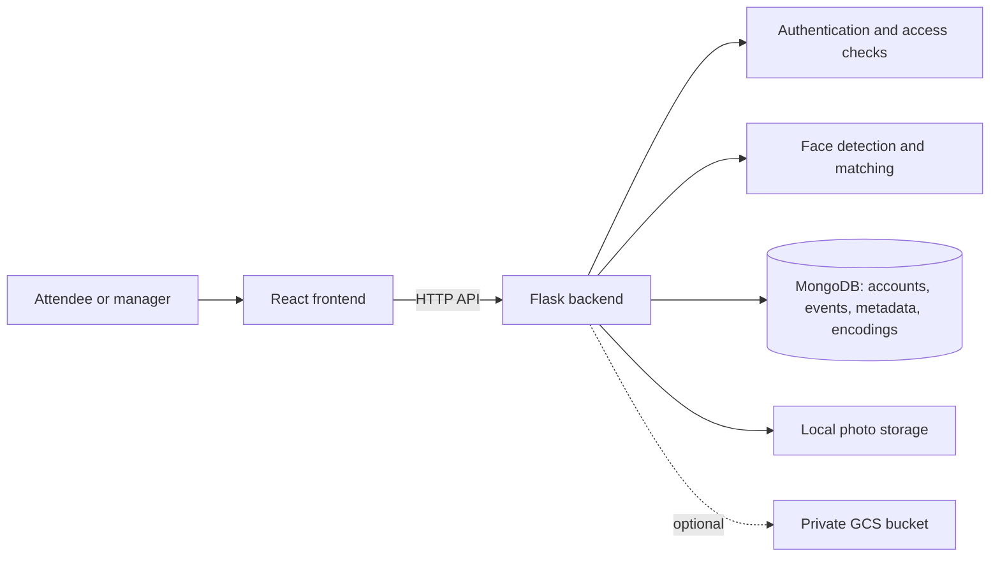

# Smart Photo Drive

**Smart Photo Drive** helps people find themselves in a collection of event photographs. An event manager creates an event and uploads photos; an attendee selects the event and submits a single-face reference photo. The application returns event photos whose stored face encodings meet the matching threshold.

This is a UCS503 Software Engineering project at Thapar Institute of Engineering and Technology. The [project proposal](project-proposal/main.pdf) describes the original goals; this README describes the current implementation.

## Contents

- [Features](#features)
- [System architecture](#system-architecture)
- [Technology stack and tradeoffs](#technology-stack-and-tradeoffs)
- [Run locally](#run-locally)
- [Configuration and access](#configuration-and-access)
- [Project layout](#project-layout)
- [Current limitations and future prospects](#current-limitations-and-future-prospects)
- [Contributors](#contributors)

## Features

- Separate attendee and event-manager accounts with password hashing and role-based JWT authentication.
- Event creation, public event browsing and search, manager photo uploads, and event deletion.
- Face detection when event photos are uploaded; encodings are saved so subsequent searches do not rescan every original image.
- Reference-photo search within one event, with ranked matches and one-hour photo links.
- Local image storage by default, with optional private Google Cloud Storage (GCS) storage and a local fallback.
- Manager dashboard showing photo, scan, scan-failure, and detected-face counts.

## System architecture



1. A manager uploads event photos. Flask validates each image, stores it, detects its faces, and saves each face's 128-value encoding with the photo record in MongoDB.
2. An attendee submits a reference image containing exactly one detectable face. The backend compares its encoding with the saved encodings for the selected event and returns photos within the configured face-distance threshold.
3. The frontend displays the matches using short-lived links. Flask validates each link before serving a local photo or redirecting to a signed GCS download URL.

Image files and application records are stored separately. Face scanning and search currently run in the Flask request process; searches compare the reference against each photo with a detected face in the selected event.

## Technology stack and tradeoffs

| Layer | Current choice | Reason and tradeoff |
| --- | --- | --- |
| Interface | React, React Router, Vite, Tailwind CSS | Supports a responsive, route-based interface and quick local builds; it requires a separate frontend development server. |
| API | Python and Flask | Keeps the API and image-processing code in one language; synchronous scanning can make large uploads slow. |
| Data | MongoDB and PyMongo | Stores flexible event/photo records and face encodings together; the current per-event search still performs a linear comparison over photos with faces. |
| Face processing | `face_recognition`/dlib, Pillow, OpenCV, NumPy | Uses an established encoding pipeline and normalizes/resizes images before scanning; native dlib installation and CPU cost can complicate setup and scaling. |
| Images | Local disk; optional private GCS bucket | Local storage makes development simple, while GCS supports external object storage; cloud setup needs credentials and a private bucket. |
| Access | bcrypt, JWT, signed photo links | Separates manager and attendee actions and limits link lifetime; links can be shared until they expire, so deployment still needs careful privacy controls. |

The displayed match score is derived from face distance. **It is a ranking aid, not a calibrated probability of identity.** The default distance threshold is `0.6`; lowering it makes matching stricter but can miss more genuine matches.

## Run locally

**Prerequisites:** Python 3.12, Node.js 20 or newer, a reachable MongoDB instance, and the native dependencies needed by dlib on your platform. Run the backend and frontend in separate terminals.

### 1. Start the backend

```bash
cd code/smart-photo-drive/smart-photo-drive-backend
python3.12 -m venv .venv
source .venv/bin/activate
pip install -r requirements.txt
```

Face search also requires `face_recognition` and dlib. On Linux x86-64, the installation documented for this project is:

```bash
pip install 'setuptools<81' dlib-bin==20.0.1.post1 face_recognition_models==0.3.0
pip install --no-deps face_recognition==1.3.0
```

Other platforms may need a compatible prebuilt dlib package or a C++ build environment. On Windows, a conda environment with `conda install -c conda-forge dlib` followed by `pip install -r requirements.txt 'setuptools<81' face_recognition` is an alternative.

Copy `.env.example` to `.env`, set `MONGO_URI` and a long random `JWT_SECRET`, then start Flask:

```bash
cp .env.example .env
# Edit .env with your MongoDB URI and JWT secret.
python app.py
```

Check `http://localhost:5000/api/health`; `face_matching_available` must be `true` for search to work. MongoDB must be reachable at startup because the backend creates indexes then. If photos were uploaded before face matching was available, run `python rescan_photos.py` after installing it.

### 2. Start the frontend

In a second terminal:

```bash
cd code/smart-photo-drive/smart-photo-drive-frontend
npm ci
npm run dev
```

Open `http://localhost:5173`. Register as a manager to create an event and upload photos, then register as an attendee to search that event with a clear, single-face reference photo. Run `npm run build` to build the frontend or `npm run lint` to check its source.

## Configuration and access

| Setting | Purpose |
| --- | --- |
| `MONGO_URI` | Required MongoDB connection URI. |
| `JWT_SECRET` | Required secret for account tokens and photo links. |
| `FRONTEND_ORIGIN` | Allowed frontend origin(s) for CORS; defaults to local Vite addresses. |
| `FACE_MATCH_THRESHOLD` | Optional face-distance cutoff; defaults to `0.6`. |
| `GCS_BUCKET_NAME`, `GOOGLE_APPLICATION_CREDENTIALS` | Optional private GCS bucket and service-account credentials. |
| `VITE_API_BASE` | Optional frontend API base URL; defaults to `http://localhost:5000`. |

Keep `.env` and service-account credentials private. Public event listings expose event details but not original photos; only the owning manager can list their event photos, and attendee searches return links for matches. Direct access to the uploads directory is disabled. A GCS bucket must have public access disabled separately. Photo links expire after one hour, and a fresh search generates new links.

The backend accepts PNG, JPEG, and WebP images, limits individual images to 20 MB and 40 megapixels, and limits a request to 80 MB. The frontend sends manager uploads in groups of three. To move existing local photos to configured GCS storage, run `python migrate_to_gcs.py` from the backend directory.

## Project layout

```text
code/smart-photo-drive/                Application source
  smart-photo-drive-frontend/         React application
  smart-photo-drive-backend/          Flask API, face processing, storage scripts
docs/                                 Diagrams and course documentation
project-proposal/                     Proposal source and PDF
project-report-prototype-stage/       Prototype report area
project-report-final/                 Final report area
```

The [proposal](project-proposal/main.pdf) and [documentation directory](docs/index.md) provide more detail. The root `Makefile` and `mkdocs.yml` belong to the course documentation site, not the application startup flow.

## Current limitations and future prospects

- **Recognition quality:** Lighting, pose, occlusion, and image quality can cause missed or incorrect matches. Evaluate a labeled photo set with precision, recall, and false-match rate, then tune the threshold.
- **Throughput:** Upload scans run during requests and searches compare against saved faces in the selected event. Background scan jobs, batch processing, and a suitable vector index could support larger collections.
- **Privacy:** Face encodings and event photos are sensitive. Add a clear retention/deletion policy, consent handling, access auditing, and deployment reviews before broader use.
- **Operations:** Local storage ties photos to one server; private GCS is available but requires configuration. Automated tests, deployment automation, and monitoring remain future work.

## Contributors

As listed in the [project proposal](project-proposal/main.pdf):

| Contributor | Student ID |
| --- | --- |
| Harshjyot Kaur | 1024031176 |
| Jaiveer Singh | 1024030976 |
| Archita Sharma | 1024030715 |
| Avneet Kaur | 1024031173 |
